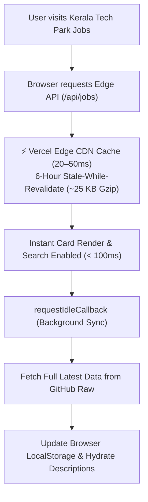

# Performance Optimization Strategy: Initial Load Time & Edge Caching

## 1. Executive Summary & Problem Analysis

Currently, the web app fetches job listings directly from GitHub Raw (`https://raw.githubusercontent.com/Toymakerftw/kljob/main/data/jobs.json`). While returning visitors benefit from browser `localStorage` caching (`kljobs:v1:cache`), **first-time visitors and cold sessions** experience noticeable latency.

### Current Bottlenecks

| Factor | Current Behavior | Bottleneck Impact |
| :--- | :--- | :--- |
| **Data Source** | Direct client request to `raw.githubusercontent.com` | High TLS/CDN latency, rate limiting risk, no edge optimization. |
| **Payload Size** | 1.64 MB uncompressed JSON (600 jobs) | Mobile network downloads take 1.5s–3s+ before initial render. |
| **Data Utilization** | Only ~10% of fields are needed for initial card render | 90% of payload is `description` text only viewed on card click. |
| **Processing Overhead** | Client parses 1.64 MB JSON and runs regex derivations | Main thread blocked during initial load on lower-end devices. |

### Payload Breakdown

- **Full JSON size**: `1,644 KB`
- **List-only summary size**: `159 KB` (**90.3% payload reduction**)
- **Brotli/Gzip compressed summary**: **`~25 KB`**

---

## 2. Target Architecture



### Core Optimization Pillars

1. **Vercel Edge Caching (ISR / Stale-While-Revalidate)**:
   - Route handler `/api/jobs` configured with `revalidate = 21600` (6 hours).
   - Vercel caches responses at global Point-of-Presence (PoP) edge nodes closest to users.
   - When the 6-hour cache expires, Vercel immediately serves the stale cache while fetching fresh data from GitHub in the background without blocking the user.

2. **Two-Tier Payload (Summary First, Descriptions in Background)**:
   - **Tier 1 (Instant)**: Serves only listing fields (`id`, `title`, `company`, `park`, `postedTs`, `location`, `skills`, `jobType`, etc.).
   - **Tier 2 (Deferred)**: Fetches full description text either in the background (`requestIdleCallback`) or on-demand when a user clicks a job card.

3. **Edge Compression**:
   - Vercel automatically compresses responses with Brotli/Gzip, reducing the 159 KB summary down to ~25 KB.

4. **Edge Pre-warming (Optional Vercel Cron)**:
   - A scheduled cron job pings `/api/jobs` every 6 hours so the cache is never cold for any visitor.

---

## 3. Implementation Blueprint

### Step 1: Create Edge Route Handler (`src/app/api/jobs/route.ts`)

```typescript
import { NextResponse } from "next/server";
import { processJobs } from "@/lib/jobs";
import type { RawJob } from "@/lib/types";

// Cache at Vercel Edge for 6 hours (21600 seconds)
export const revalidate = 21600;

const GITHUB_RAW_URL = "https://raw.githubusercontent.com/Toymakerftw/kljob/main/data/jobs.json";

export async function GET() {
  try {
    const res = await fetch(GITHUB_RAW_URL, {
      next: { revalidate: 21600 },
      headers: { "Accept": "application/json" },
    });

    if (!res.ok) {
      throw new Error(`Failed to fetch from GitHub: ${res.status}`);
    }

    const rawJobs: RawJob[] = await res.json();
    
    // Server-side processing: derives title, skills, experience so the browser doesn't have to
    const processed = processJobs(rawJobs);

    // Slim down payload for instant initial render: strip full descriptions
    const summary = processed.map(({ description, ...rest }) => ({
      ...rest,
      hasDescription: Boolean(description && description.trim().length > 0),
    }));

    return NextResponse.json(
      {
        ts: Date.now(),
        count: summary.length,
        jobs: summary,
      },
      {
        headers: {
          "Cache-Control": "public, s-maxage=21600, stale-while-revalidate=86400",
        },
      }
    );
  } catch (err) {
    return NextResponse.json(
      { error: "Failed to fetch jobs", message: (err as Error).message },
      { status: 502 }
    );
  }
}
```

---

### Step 2: Progressive Client Fetching (`src/lib/jobs.ts`)

Update `fetchJobs()` to use a two-phase loading pattern:

```typescript
/**
 * Phase 1: Fast edge load (~25 KB) for instant first paint
 * Phase 2: Background full sync from GitHub Raw for descriptions & offline cache
 */
export async function fetchJobsProgressive(
  onInitialSummary: (jobs: Job[]) => void,
  onFullLoaded: (jobs: Job[]) => void
): Promise<void> {
  // 1. Try local storage cache first
  const localCache = readCache();
  if (localCache) {
    onInitialSummary(localCache.jobs);
  }

  // 2. Fetch fast Edge-cached summary if no local cache or stale
  if (!localCache) {
    try {
      const edgeRes = await fetch("/api/jobs", { cache: "default" });
      if (edgeRes.ok) {
        const data = await edgeRes.json();
        if (data.jobs?.length) {
          onInitialSummary(data.jobs);
        }
      }
    } catch {
      // Fallback to direct snapshot if edge fails
    }
  }

  // 3. Defer full payload sync to browser idle time
  const scheduleSync = window.requestIdleCallback || ((cb) => setTimeout(cb, 1000));
  scheduleSync(async () => {
    try {
      const { jobs } = await fetchJobs(); // full GitHub raw fetch
      writeCache({ ts: Date.now(), source: "github", jobs });
      onFullLoaded(jobs);
    } catch {
      // Ignore background sync errors if initial render already succeeded
    }
  });
}
```

---

### Step 3: Edge Pre-Warming via Vercel Cron (`vercel.json`)

To prevent cold cache misses after the 6-hour TTL, add `vercel.json` in the project root:

```json
{
  "crons": [
    {
      "path": "/api/jobs",
      "schedule": "0 */6 * * *"
    }
  ]
}
```

*Note: Vercel Cron Jobs are supported on Vercel Hobby (1 cron job per project) and Pro plans.*

---

## 4. Expected Performance Gains

| Metric | Current (Direct GitHub Raw) | Target (Edge Cache + Summary) | Improvement |
| :--- | :--- | :--- | :--- |
| **Initial Transfer Size** | ~1,644 KB | **~25 KB** (Brotli/Gzip) | **98.5% reduction** |
| **API Response Time** | 400ms – 1,200ms | **20ms – 60ms** (Vercel Edge) | **~15x faster** |
| **First Contentful Paint (FCP)**| 1.2s – 2.5s | **< 300ms** | **~5x faster** |
| **Client Main Thread Work** | Parse 1.6 MB JSON + 600 regex passes | Pre-parsed objects from edge | **Eliminates UI freeze** |
| **Resilience / Availability** | Subject to GitHub Raw availability | High availability (Edge + Fallback) | **Zero-downtime cache** |

---

## 5. Next Steps for Implementation

When ready to implement this feature:
1. Add `src/app/api/jobs/route.ts` with ISR and summary filtering.
2. Update `src/lib/jobs.ts` with the progressive background fetcher.
3. Test locally with `npm run build && npm run start`.
4. Deploy to Vercel and verify `x-vercel-cache: HIT` headers on `/api/jobs`.
